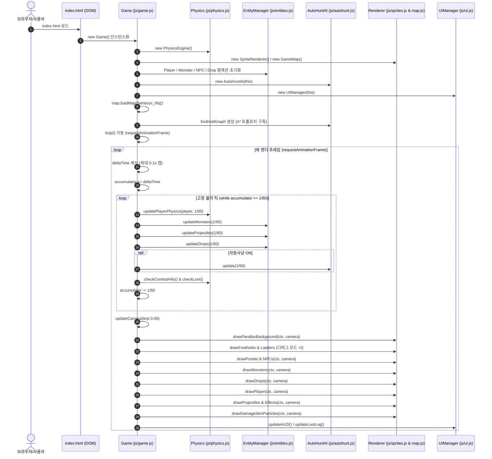

# 🏛️ OpenMaple Classic 클라이언트 아키텍처 명세서 (Architecture Specification)

본 문서는 **OpenMaple Classic** 웹 클라이언트의 소프트웨어 아키텍처, 런타임 수명 주기, 데이터 파이프라인, 물리/렌더링/인공지능 모듈의 내부 동작 원리를 기술한 공식 아키텍처 설계 명세서임.

---

## 1. 시스템 개요 및 핵심 설계 원칙

OpenMaple Classic은 2000년대 클래식 메이플스토리(Pre-Big Bang) 특유의 물리 일루전(Game Feel), 2등신 페이퍼돌 그래픽, WZ 기반 선분 발판 지형, 타격감 연출을 웹 표준 환경에서 재현하는 순수 바닐라 2D 게임 클라이언트임.

### 핵심 설계 원칙 (Core Principles)
1. **Zero-Build & Zero-Dependency (순수 웹 표준)**
   - Webpack, Vite, React, Babel 등의 번들러나 트랜스파일러를 일절 사용하지 않음.
   - 브라우저의 기본 기능(HTML5 Canvas, CSS3, Web Audio API, ES6 모듈/글로벌 스코프)만으로 동작함.
   - 브라우저에서 `index.html`을 열거나 초경량 로컬 파이썬 서버(`python server.py`)로 지연 없이 즉시 구동됨.
2. **Deterministic 60Hz Fixed Timestep (결정론적 고정 시간 스텝 물리)**
   - 가변 델타타임($\Delta t$)에 물리 연산을 위임하지 않고, `accumulator` 기반 60Hz 고정 스텝(16.66ms)을 적용하여 프레임 드랍 시에도 발판 뚫림(Tunneling) 현상을 원천 방지함.
3. **Line Segment Foothold Physics (선분 발판 물리)**
   - 단순 사각형(AABB) 충돌을 전면 배제하고, 원작 메이플스토리의 WZ 선분 데이터(`x1, y1` ~ `x2, y2`) 기반 선형 보간 흡착 물리를 구현함.
4. **Decoupled Modular Architecture (비동기 모듈 분리)**
   - 전역 네임스페이스(`window.game`, `window.sprites`, `window.audio` 등)를 명확히 분리하여 컴포넌트 간 단방향 데이터 흐름을 유지함.
5. **Zero-Error CDP Automation (무결점 자동화 검증)**
   - Headless Chrome DevTools Protocol(CDP) 러너(`run_qa.py`)를 통해 전 맵 이동, 보스전, 스킬, UI 동작 시 콘솔 에러 0건을 자동 보장함.

---

## 2. 전체 디렉토리 및 파일 구조

```
openmaple/
├── index.html                       # 메인 진입점, Canvas 뷰포트, DOM 기반 레트로 HUD & 윈도우 UI
├── style.css                        # 클래식 메이플 스타일시트, 창 드래그, 폰트, 팝업, 툴팁
├── server.py                        # 파이썬 3 내장 로컬 HTTP 정적 서버 (포트 8000)
├── run.bat                          # 윈도우 원클릭 실행 배치 파일
├── run_qa.py                        # Chrome CDP 헤드리스 자동화 QA 및 에러 검출 러너
├── CLASSIC_SPEC.md                  # 빅뱅 전 클래식 메이플스토리 공식 고증 명세서
├── ARCHITECTURE.md                  # [본 문서] 시스템 아키텍처 및 모듈 상세 명세서
├── CONTRIBUTING.md                  # 개발자 및 LLM 에이전트 기여 가이드
├── AGENTS.md                        # AI 코딩 에이전트 불변 행동 강령 및 표준 지침
├── .cursorrules                     # Cursor AI 전용 프로젝트 룰셋
├── .github/
│   └── copilot-instructions.md      # GitHub Copilot 전용 지침
├── assets/                          # 정적 WZ 추출 및 그래픽/오디오 리소스
│   ├── map/                         # 5대 공식 맵 WZ 지형, 배경, 미니맵, JSON 선분 데이터
│   ├── monsters/                    # 클래식 몬스터/보스 스프라이트 (스탠드, 무브, 히트, 다이)
│   ├── npcs/                        # 클래식 NPC 스프라이트 (모범택시, 중형택시, 스탄, 아도비스 등)
│   ├── player/                      # 5대 직업군(초보자, 전사, 마법사, 궁수, 도적) 페이퍼돌 프레임
│   ├── projectiles/                 # 화살, 에너지볼트, 표창 투사체
│   └── ui/                          # 클래식 대미지 스킨(일반/크리티컬), 메소스프라이트
└── js/                              # 순수 바닐라 클라이언트 게임 엔진 코어
    ├── map_data.js                  # 5대 맵의 선분 발판, 사다리, 몬스터 스폰, NPC, 포탈 정적 정의
    ├── audio.js                     # Web Audio API 기반 오실레이터 프로시저럴 BGM 및 SFX 신디사이저
    ├── physics.js                   # 60Hz 누적기, 선분 발판 흡착, 하향 점프, 사다리 클라이밍 물리
    ├── sprites.js                   # 페이퍼돌 렌더러, 대미지 폰트 바운스, 히트 플래시, 파티클
    ├── map.js                       # 맵 로더, 3중 패럴랙스 배경, 카메라 바운드, 포탈/NPC 렌더링
    ├── entities.js                  # 플레이어, 몬스터, 자쿰 8개 팔 보스, 투사체, 드롭템 엔티티
    ├── autohunt.js                  # 위상 발판 그래프(FootholdGraph), A* 길찾기, 지능형 사냥 AI
    ├── ui.js                        # 드래그 윈도우, 스탯, 인벤토리, 스킬, 대화창, 루팅 로그 관리
    └── game.js                      # 메인 게임 루프, 키보드 입력, 카메라 보간, 씬 오케스트레이션
```

---

## 3. 런타임 수명 주기 및 실행 흐름 (Runtime Lifecycle)

클라이언트는 브라우저 로딩 시 다음 단계로 순차 초기화되며, 단일 `requestAnimationFrame` 루프를 통해 렌더링과 고정 물리 연산을 분리 실행함.



---

## 4. 핵심 모듈 상세 설계

### 4.1. 물리 엔진 (`js/physics.js`)
메이플스토리 오리지널 물리 동작을 수학적으로 재현함.

1. **선분 발판 충돌 및 표면 흡착 (Foothold Line Math):**
   - 발판 데이터: `{ id, x1, y1, x2, y2 }`
   - 착지 판정 조건:
     - 수평 범위: `x1 <= player.x && player.x <= x2`
     - 낙하 속도: `player.vy >= 0` (하강 중일 때만 착지, 아래에서 위로 점프 시 관통)
     - 수직 접촉: 이전 프레임 `prevY <= footholdY + tolerance` 이고 현재 `player.y >= footholdY`
   - 선형 보간(Linear Interpolation) 흡착:
     $$y = y_1 + \frac{y_2 - y_1}{x_2 - x_1} \cdot (x - x_1)$$
   - 경사면을 이동할 때 플레이어의 수평 속도에 맞춰 $y$ 좌표가 즉각 흡착되어 미끄러지거나 덜컹거리지 않음.
2. **하향 점프 (Drop-Through Platform):**
   - `↓ + Jump` 입력 시 플래그 `dropThroughUntilY = player.y + 12` 설정.
   - 현재 발판의 흡착을 강제로 해제하고, 해당 $y$ 임계치를 지나기 전까지 아래 발판 착지 검사를 일시 생략하여 하단 발판으로 자연스럽게 낙하함.
3. **사다리 / 밧줄 시스템 (Ladder Clamping):**
   - 사다리 중심선 `ladder.x ± 12px` 반경 내에서 `↑` 또는 `↓` 키 입력 시 사다리 상태(`player.onLadder = true`)로 전환.
   - 캐릭터의 수평 좌표가 `player.x = ladder.x`로 강제 스냅(Snap).
   - 등반 중 키를 떼면 중력이 0이 되어 매달림 상태를 유지하며, `Jump` 입력 시 사다리를 박차고 튕겨 나감.
4. **상수 파라미터:**
   - 중력 가속도: $g = 0.52 \text{ px/tick}^2$
   - 기본 점프 속도: $v_{jump} = -9.8 \text{ px/tick}$
   - 지상 마찰 감속 계수: $\mu = 0.82$
   - 공중 좌우 가속도: $a_{air} = 0.18$

---

### 4.2. 월드 & 맵 엔진 (`js/map.js`, `js/map_data.js`)
실제 WZ 추출 데이터 기반의 5개 핵심 맵을 실시간 전환 지원함.

| 맵 키 (Key) | 맵 명칭 (Name) | 발판 수 | 사다리 수 | 주요 특징 |
| :--- | :--- | :--- | :--- | :--- |
| `henesys_hhg` | 헤네시스 사냥터 1 | 153 | 8 | 4단 초원 지형, 달팽이/슬라임/버섯 스폰, 단풍나무 |
| `henesys_town` | 헤네시스 마을 | 220 | 2 | 버섯 가옥, 장로스탄/마야/모범택시 NPC, 상점 |
| `ant_tunnel` | 던전: 개미굴 1 (105050000) | 370 | 11 | 원본 선분 498개 중 수직 벽을 제외한 발판. 종유석 동굴, 좀비버섯/뿔버섯 서식 |
| `ellinia` | 엘리니아 | 1217 | 37 | 거대 에메랄드 세계수, 요정/마법사 마을, 고공 사다리망 |
| `zakum_altar` | 자쿰의 제단 | 166 | 2 | 용암 기둥, 8개 팔을 지닌 보스 자쿰 전용 보스 레이드 필드 |

- **3중 패럴랙스 배경 (Parallax Scrolling):**
  - 원경(Sky/Clouds): 스크롤 팩터 `0.08`
  - 중경(Far Trees/Mountains): 스크롤 팩터 `0.35`
  - 근경(Map Platforms): 스크롤 팩터 `1.00`
- **카메라 보간 (Smooth Camera Tracking):**
  - 플레이어 중심 부드러운 Lerp 추적 (`camera.x += (targetX - camera.x) * 0.08`).
  - 맵의 경계(`minX, maxX, minY, maxY`)를 벗어나지 않도록 화면 경계 하드 클램핑.

---

### 4.3. 엔티티 및 전투/장비/보스 시스템 (`js/entities.js`)

1. **정통 명중률(Accuracy) & 회피율(Avoid)에 의한 MISS 판정 엔진:**
   - 플레이어 물리 명중치: $\text{Acc} = \text{totalDex} \times 0.8 + \text{totalLuk} \times 0.5$ (마법사는 INT/LUK 비례)
   - 몬스터 회피율 및 레벨차 기반 요구 명중치:
     $$\text{NeedAcc} = \text{MobAvoid} \times (1.84 + 0.07 \times \max(0, \text{MobLv} - \text{PlayerLv}))$$
   - $\text{Acc} < \text{NeedAcc}$ 시 적중률 $\text{HitRate} = \max(0.05, \text{Acc} / \text{NeedAcc})$ 에 따라 `MISS` 발생.
   - `MISS` 시 몬스터 피격/경직이 발생하지 않으며, 3D `MISS` 텍스트가 위로 부유함.
2. **장비 장착 파이프라인 및 주문서 강화 (Equipment & Scrolling Engine):**
   - 무기/모자/방패/투구 장비 장착(`toggleEquip`) 시 공격력, 방어력, 스탯이 플레이어 최종 전투 스펙에 실시간 가산.
   - 장비 업그레이드 슬롯(`upgradeSlots: 7회`).
   - 주문서(무기 공격력 주문서 60%, 10%) 사용 시 고유 확률에 따라 성공(+공격력) 또는 실패(업횟만 차감) 판정 및 오디오/비주얼 연출.
3. **사망 페널티 및 묘비 연출 (Death Penalty & Tombstone):**
   - 사망 시 현재 레벨 경험치 10% 증발 ($\text{LostExp} = \lfloor \text{maxExp} \times 0.10 \rfloor$).
   - 화면 진동(`triggerScreenShake`), 슬픈 종소리와 함께 둥근 아치형 석조 묘비(십자가 각인, 셀 셰이딩) 및 머리 위 아기 천사/유령 승천 애니메이션 렌더링.
4. **인기도 시스템 (Fame):**
   - 플레이어 고유 인기도 스탯 및 스탯창 UI 표기.
   - NPC(장로스탄, 마야) 퀘스트 완료 시 인기도(+5, +10) 보상 지급.
5. **자쿰 보스 레이드 및 1/1 광역기 (`ZakumBoss`):**
   - 100,000 HP의 석상 본체 + **8개의 독립 부속 팔(Arm 1 ~ Arm 8, 각 15,000 HP)**.
   - 각 팔은 원본 WZ 기준점으로 본체에 연결되며 8프레임 애니메이션, 실제 불투명 영역 피격, 독립 HP 및 파괴 상태를 유지함. 본체 뒤에 가려진 뿌리는 피격에서 제외함.
   - **자쿰 1/1 저주 스킬**: 마법진 전개 후 플레이어의 HP/MP를 즉시 1/1로 만들고 4초간 허약(점프 불가) 상태이상 부여.
   - 화염 기둥(`fire_pillar`), 번개 낙뢰(`lightning`).
   - 처치 시 '👑 자쿰의 투구', 10만 메소 다발 등 드롭.
6. **NPC 및 모범택시 시스템 (`Npc`):**
   - 마을 및 던전의 NPC(중형택시, 모범택시, 장로스탄, 마야, 아도비스).
   - 상호작용(`Space` 키) 시 전용 양피지 다이얼로그 모달 오픈, 목적지 선택 시 즉시 맵 텔레포트 및 퀘스트 수행.

---

### 4.4. 타격감 연출 및 렌더러 (`js/sprites.js`)

1. **클래식 대미지 스킨 (Damage Skin Blit & Delay Particle):**
   - 대미지 숫자가 통째로 출력되지 않고 각 자릿수(예: 8, 4, 2, 0)가 분리됨.
   - 자릿수마다 **0.04초의 시차 딜레이**를 두고 순차적으로 솟구침 ($v_y = -5.0$, $g = 0.4$).
   - 크리티컬 발생 시 대미지 배율 1.4배 폰트 크기 및 상단 'CRITICAL' 이펙트 표기.
2. **피격 리액션 및 무적 시간 (i-Frame & Hitstop):**
   - 몬스터 피격 순간 0.08초 히트스탑(정지) 발생.
   - 0.12초간 흰색 실루엣 마스크 오프스크린을 덮어씌워 강렬한 피격 플래시 연출.
   - 공격 방향 기준 포물선 넉백 ($v_x = \text{hitDir} \cdot 3.2, v_y = -2.0$).
   - 플레이어 피격 시 1.2초간 무적 시간 및 스프라이트 점멸 투명도(`opacity: 0.4 <-> 1.0`).
3. **묘비 및 영혼 승천 렌더링:**
   - 석조 묘비(아치형 상단, 음각 십자가, R.I.P 텍스트) + 상공에서 날개짓하는 아기 천사/유령 스프라이트.
4. **임팩트 파티클 및 화면 진동:**
   - 착지 시 양옆으로 퍼지는 반원형 흰색 먼지 구름 4개 생성.
   - 급제동 및 방향 전환 시 바닥 마찰 스키드 파티클 생성.
   - 강한 피격 / 사망 / 1/1 저주 피격 시 화면 진동(`camera shake`).

---

### 4.5. 지능형 자동사냥 AI (`js/autohunt.js`)

1. **위상 발판 그래프 (Foothold Graph & A\* Pathfinding):**
   - 맵 로드 시 모든 발판(노드)과 사다리/하향낙하지점(에지)을 전수 분석하여 그래프를 자동 구축.
   - 타겟 몬스터가 다른 층에 위치할 경우, A* 알고리즘으로 최단 경로(경유 발판 $\to$ 사다리 $\to$ 하향점프)를 계산하여 순차 명령 큐 실행.
2. **사냥 상태 머신 (FSM):**
   - `IDLE` $\to$ `FIND_TARGET` $\to$ `NAVIGATE_TO_TARGET` $\to$ `APPROACH_AND_ATTACK` $\to$ `AUTO_LOOT` $\to$ `AUTO_POTION`.
3. **끼임 방지 (Anti-Stuck Watchdog):**
   - 0.5초 동안 유의미한 변위(10px 미만)가 발생하지 않을 경우 끼임으로 판정.
   - 즉시 현재 명령을 취소하고 좌우 무작위 점프 후 안전 발판으로 재탐색 수행.

---

### 4.6. 사운드 신디사이저 엔진 (`js/audio.js`)
- 외부 오디오 파일 다운로드 없이 브라우저 내장 `AudioContext`의 Oscillator와 GainNode를 결합하여 레트로풍 사운드를 100% 프로시저럴 합성.
- 점프, 공격 베기, 타격음, 몬스터 피격/처치, 동전 습득, 물약 복용, 레벨업 팡파레 및 헤네시스풍 BGM 생성.

---

### 4.7. UI 및 HUD 시스템 (`js/ui.js`)
- **드래그 가능 윈도우**: 스탯창(`S`), 인벤토리(`I`), 스킬창(`K`), 자동사냥 설정창(`O`).
- **클래식 대화창 & 말풍선**: NPC 대화 모달, 하단 인게임 채팅창(전체/파티/길드), 캐릭터 머리 위 4초 지속 말풍선.
- **실시간 루팅 로그**: 우측 하단 경험치/메소/아이템 획득 시 3.2초간 부드럽게 페이드아웃되는 플로팅 로그.

---

## 5. 자동화 QA 및 무결점 보증 (`run_qa.py`)

- **헤드리스 Chrome DevTools Protocol(CDP) 자동화**:
  - `Runtime.enable`, `Log.enable`을 통해 브라우저 내부의 모든 `console.error`, 미처리 Promise 거부(`UnhandledRejection`), 문법 에러를 실시간 수집.
  - 맵 전환(헤네시스 $\to$ 헤네시스 마을 $\to$ 개미굴 $\to$ 엘리니아 $\to$ 자쿰의 제단), 몬스터 타격, 자쿰 팔 공격, 스킬 시전, UI 드래그를 10초간 시뮬레이션.
  - 콘솔 에러가 단 1건도 발생하지 않을 때만 성공(PASS)으로 판정.


### 자쿰 원본 조립과 실제 플레이 계약

- `assets/monsters/zakum/origins_source.json`은 GMS 62 원본 72프레임의 WZ origin 출처이고, `origins.json`은 기존 PNG 여백에 대응한 기준점이다. 생성기에서 기준점과 alpha 마스크를 함께 굽는다.
- 원본 지형 166개 선분에 중복 발판을 만들지 않는다. 원본 줄 2개와 원본 발판을 연결하는 보조 줄 5개를 사용한다.
- 위상 그래프는 연속 walk 경로를 압축하고 물리적으로 가능한 단차 점프를 연결한다. 상단 팔은 원본 발판에서 달리기 점프로 공격하고, 착지·넉백 후 경로를 재평가한다.
- 보스 화면은 전체 조립 및 발판 범위에 맞춘 world camera zoom을 사용한다. 실제 CSS 캔버스 크기, 화면→월드 좌표, HUD·미니맵을 같은 변환으로 유지한다.
- 완료 검증에는 `test_zakum_assembly.py`, `test_zakum_playability.py`, `test_responsive_ui.py`를 포함한다. 단순히 bbox와 그리기 좌표가 서로 같은지만으로 원본 조립·가시 타격을 증명하지 않는다.
