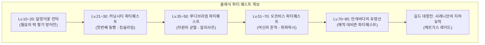
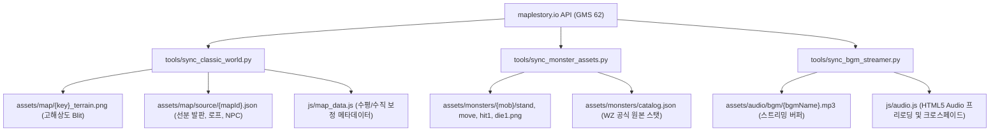

# 🍁 클래식 메이플스토리(Pre-Big Bang) 컨텐츠·에셋 총람 (The Complete Classic Archive)
> **문서 번호:** ARCHIVE-2026-CLASSIC-01  
> **기준 버전:** 클래식 메이플스토리 GMS 62 / KMS 1.2.41 (2004~2007 황금기)  
> **목적:** OpenMaple 프로젝트의 장기적인 컨텐츠 확장, 공식 WZ 에셋 추출 및 정통 클래식 시스템 복원을 위한 총체적 데이터베이스

---

## 1. 전 대륙 및 지역별 WZ 맵 아카이브 (World Map Topography)

빅뱅 이전 메이플스토리의 세계는 물리적 이동의 번거로움과 탐험의 스릴이 공존하는 유기적인 거대 오픈월드였습니다. 모든 맵은 고유의 WZ Map ID를 가지며, 발판(`Footholds`), 사다리/밧줄(`LadderRopes`), NPC 및 포탈 연결망으로 구성됩니다.

```
[세계 전도 (World Map)]
├── 🏝️ 메이플 아일랜드 (초보자 튜토리얼)
├── 🍁 빅토리아 아일랜드 (6대 마을 & 중심 던전)
│     ├── 리스항구, 헤네시스, 엘리니아, 페리온, 커닝시티, 슬리피우드, 노틸러스
│     └── 히든스트리트: 돼지의 해안가, 남쪽숲 나무던전, 원숭이의 숲, 골렘의 사원
├── 🚢 대륙간 정기선 (비행선 항해 & 크림슨발록 난입)
└── 🌐 오시리아 대륙 (초거대 연방 대륙)
      ├── ☁️ 오르비스 & 오르비스 탑 (1~20층)
      ├── ❄️ 엘나스 산맥 (얼음골짜기, 폐광, 죽은나무의 숲 1~4, 시련의 동굴, 자쿰의 제단)
      ├── 🧸 루더스 호수 - 루디브리엄 (에오스 탑 1~100층, 헬리오스 탑)
      │     ├── 🛸 지구방위본부 (외계인 격납고)
      │     ├── 📜 아랫마을 (전래동화 까막산)
      │     └── 🕰️ 시계탑 최하층 (뒤틀린/잊혀진 시간의 길, 파풀라투스 시계탑)
      ├── 🌊 아쿠아로드 (아쿠아리움, 심해 협곡, 피아누스의 동굴)
      ├── 🏜️ 니할 사막 (아리안트 궁전, 마가티아 연구소 C-1/C-2)
      ├── 🐼 무릉도원 (무릉 사원, 무릉도장, 백초마을 도라지골, 데비존 해적선)
      ├── 🐉 미나르숲 - 리프레 (용의 숲, 용의 둥지, 남겨진 용의 둥지, 혼테일의 동굴)
      └── ⏳ 시간의 신전 (추억/후회/망각의 길, 신전 깊은 곳, 핑크빈 제단)
```

### 1.1. 빅토리아 아일랜드 (Victoria Island) 맵 데이터베이스

| 지역명 | 맵 명칭 (Map Name) | 공식 WZ MapId | 권장 레벨 | 주요 서식 몬스터 | BGM 테마 |
| :--- | :--- | :--- | :--- | :--- | :--- |
| **리스항구** | 리스항구 항구마을 | `104000000` | Lv.1~10 | 달팽이, 스포아 | `StartTheAdventure` |
| **헤네시스** | 헤네시스 마을 | `100000000` | 전 레벨 | 마을 (NPC 마야, 장로스탄) | `RestingSpot` |
| | 헤네시스 사냥터 1 (1~4층) | `104040000` | Lv.1~15 | 달팽이, 슬라임, 주황버섯, 초록버섯, 리본돼지 | `RestingSpot` |
| | 버섯초원 | `104030000` | Lv.10~18 | 주황버섯, 옥토퍼스 | `RestingSpot` |
| | 헤네시스 동쪽풀숲 | `104040001` | Lv.15~22 | 돼지, 리본돼지, 아이언호그 | `RestingSpot` |
| | 골렘의 사원 1~4 | `104040002` | Lv.50~60 | 스톤골렘, 다크스톤골렘 | `FloralLife` |
| **페리온** | 페리온 바위마을 | `102000000` | 전 레벨 | 전사 전직소 (주먹펴고 일어서) | `Nightmare` |
| | 서부 바위산 1~4 | `102020000` | Lv.15~25 | 스텀프, 다크스텀프 | `Nightmare` |
| | **와일드보어의 땅 (와보땅)** | `102020300` | Lv.25~35 | **와일드보어, 다크스텀프** | `Nightmare` |
| | 유적발굴지 1~3 | `102030000` | Lv.35~45 | 우드마스크, 화이트마스크 | `Nightmare` |
| | 유적발굴단 캠프 / 제1군영 | `102030400` | Lv.45~60 | 스켈레톤 사병, 스켈레톤 장교 | `Nightmare` |
| | **히든: 돼지의 해안가** | `104010102` | Lv.12~25 | **돼지, 리본돼지, 아이언호그(기습)** | `RestingSpot` |
| **커닝시티** | 커닝시티 도시 뒷골목 | `103000000` | 전 레벨 | 도적 전직소 (다크로드) | `BadGuys` |
| | **커닝시티 지하철 1호선** | `103000100` | Lv.20~35 | 버블링, 주니어레이스 | `BadGuys` |
| | **커닝시티 지하철 2호선** | `103000200` | Lv.35~50 | **레이스, 주니어레이스 (클레릭 성지)**| `BadGuys` |
| | 방황의 늪 1~3 | `103010100` | Lv.30~45 | 주니어네키, 리게이터, 크로코 | `Swamp` |
| **엘리니아** | 엘리니아 신목 마을 | `101000000` | 전 레벨 | 마법사 전직소 (하인즈) | `WhenTheMorningComes` |
| | 지혜의 숲 | `101020000` | Lv.20~35 | 초록버섯, 뿔버섯 | `WhenTheMorningComes` |
| | 원숭이의 숲 (나무던전 1) | `101030100` | Lv.35~45 | 루팡, 좀비루팡 | `WhenTheMorningComes` |
| | 나무줄기 둥지 | `101040000` | Lv.30~40 | 커즈아이 | `WhenTheMorningComes` |
| **슬리피우드**| 슬리피우드 호텔/사우나 | `105040300` | 전 레벨 | 사우나 피 회복, 인내의 숲 입구 | `Sleepywood` |
| | **개미굴 1 (국민 6인 파티)**| `105050000` | Lv.20~30 | **뿔버섯, 좀비버섯 (언데드)** | `Sleepywood` |
| | 또 다른 입구 | `105040300` | Lv.35~45 | 커즈아이, 콜드아이 | `Sleepywood` |
| | **저주받은 신전** | `105090300` | Lv.70~90 | 타우로마시스, 타우로스피어 | `EvilGlory` |
| | **신전 깊은 곳 (발록의 무덤)**| `105090900` | Lv.80~100| **주니어발록 (보스)** | `EvilGlory` |

---

### 1.2. 오시리아 대륙 핵심 맵 데이터베이스

| 지역명 | 맵 명칭 (Map Name) | 공식 WZ MapId | 권장 레벨 | 주요 서식 몬스터 | BGM 테마 |
| :--- | :--- | :--- | :--- | :--- | :--- |
| **비행선 항해**| 엘리니아 $\leftrightarrow$ 오르비스 배 | `200090000` | 전 레벨 | **크림슨발록 (갑판 난입 보스)** | `UponTheSky` |
| **오르비스** | 오르비스 마을 (천공의 도시)| `200000000` | 전 레벨 | 마을 (요정 크리엘, 네펜데스) | `Shinin'Harbor` |
| | 구름공원 1~6 | `200010100` | Lv.40~55 | 스타픽시, 루나픽시, 러스터픽시 | `CloudPark` |
| | 오르비스 탑 1~20층 | `200080100` | Lv.35~50 | 주니어스톤볼, 스톤볼, 아이스스톤볼| `TowerOfGoddess` |
| **엘나스** | 엘나스 만년설 마을 | `211000000` | 전 레벨 | 3차 전직소 (장로의 관), 아이젠 상점| `SnowyVillage` |
| | 얼음골짜기 1~2 | `211030100` | Lv.50~65 | 주니어예티, 예티, 페페 | `IceCave` |
| | 차디찬벌판 | `211030000` | Lv.60~75 | 헥터, 화이트팽, **예티와 페페** | `IceCave` |
| | **죽은나무의 숲 1~4 (죽숲)**| `211040300` | Lv.55~70 | **쿨리좀비 (클레릭/프리스트 최대 성지)**| `WarmRegard` |
| | 시련의 동굴 1~3 | `211040800` | Lv.80~95 | 주니어독, 파이어독 (화염 지대) | `CaveOfTrials` |
| | **자쿰의 제단** | `280030000` | Lv.100~140| **고대 거신 자쿰 (8개 팔 + 본체)** | `ZakumBgm` |
| **루디브리엄**| 루디브리엄 장난감 성 | `220000000` | 전 레벨 | 장난감 마을, 에오스/헬리오스탑 | `FantasticFactory` |
| | 에오스 탑 1~100층 | `221020000` | Lv.30~45 | 라츠, 블랙라츠, 트릭스터, 블록골렘| `EosTower` |
| | **잊혀진 시간의 길 3** | `220070200` | Lv.80~95 | **듀얼파이렛 (원거리 낚시 사냥터)** | `TimeAttack` |
| | **뒤틀린 시간의 길 3** | `220060200` | Lv.85~100| **바이킹, 기간틱 바이킹** | `TimeAttack` |
| | 시계탑 깊은 곳 (알현실) | `220080000` | Lv.110~130| **파풀라투스 (2페이즈 시계탑 보스)**| `PapulatusBgm` |
| **아쿠아로드**| 아쿠아리움 (심해 마을) | `230000000` | 전 레벨 | 수중 유영 물리 엔진, 돌고래 택시 | `Aquarium` |
| | 위험한 바다 협곡 1~2 | `230040100` | Lv.75~90 | 샤크, 콜드샤크, 본피쉬 | `DeepSea` |
| | 피아누스의 동굴 | `230040420` | Lv.110~125| **피아누스 (좌/우 거대 물고기 보스)**| `PianusBgm` |
| **마가티아** | 연구소 C-1, C-2 구역 | `261020300` | Lv.65~80 | **로이드, 네오휴로이드 (일자 평지)** | `MagatiaLab` |
| | 연구소 202호 | `261020402` | Lv.75~90 | 호문쿨루스, D.로이 | `MagatiaLab` |
| **리프레** | 미나르숲 리프레 마을 | `240000000` | 전 레벨 | 4차 전직 마을, 타타모 | `Leafre` |
| | 불/물/어둠 켄타우로스의 영역| `240010400` | Lv.88~95 | 켄타우로스 3종 속성 | `MinarForest` |
| | **남겨진 용의 둥지 (남둥)** | `240040511` | Lv.110~125| **스켈레곤, 스켈로스 (4차 광역 사냥터)**| `DragonNest` |
| | **혼테일의 동굴** | `240060200` | Lv.140~160| **혼테일 (3개 머리 + 5개 파츠 레이드)**| `HorntailBgm` |
| **시간의신전**| 추억 / 후회 / 망각의 길 | `270010000` | Lv.120~155| 신관, 사제, 수호병, 라이카, 도도 | `TempleOfTime` |
| | **신전 깊은 곳 (혼돈의 결계)**| `270050000` | Lv.160~180| **핑크빈 (5대 석상 + 본체)** | `PinkBeanBgm` |

---

## 2. 클래식 파티 퀘스트 & 상징적 기믹 시스템 (Party Quests & Mechanics)

메이플스토리의 진정한 전성기는 유저 간 협동과 두뇌 플레이가 요구되던 **파티 퀘스트(PQ)**와 피지컬을 시험하던 **점프맵(Jump Map)**이었습니다.



### 2.1. 커닝시티 파티퀘스트 (첫번째 동행, Lv.21~30)
- **입장 NPC**: 라케리스 (커닝시티 골목길, 파티원 4명 필수)
- **단계별 기믹 구성**:
  1. **1단계 (통행증 수수께끼)**: 파티원 각자 발판에 흩어져 쿠폰을 모으고, 파티장의 수학 문제(예: 파티원의 레벨 합, 스탯 등) 정답만큼 통행증 제출.
  2. **2단계 (밧줄 매달리기)**: 4가닥의 밧줄 중 3명의 파티원이 올바른 조합(3-of-4)으로 매달려 벨을 울림.
  3. **3단계 (고양이 발판)**: 5개의 발판 위에 3명이 올라서서 올바른 번호 조합을 찾아내는 순열 추론.
  4. **4단계 (통나무 배럴)**: 6개의 나무통 위에 3명이 올라서는 최종 조합 퍼즐.
  5. **마지막 단계 (보스 킹슬라임 토벌)**:
     - 맵 중앙에서 **킹슬라임(Lv.35 / HP 8,000)** 소환.
     - 슬라임들을 주기적으로 소환하며 거대한 젤리 바운스 공격.
     - 보상: **말랑말랑한 신발** (올스탯 +1, 이속 +5), 주문서 10%/60%.

### 2.2. 루디브리엄 파티퀘스트 (차원의 균열, Lv.35~50)
- **입장 NPC**: 양 (에오스 탑 101층)
- **주요 기믹**:
  - 라츠/블랙라츠 섬멸 통행증 수집.
  - 상자 부수기 비밀 함정 방 (워프 함정 회피).
  - 8단계 넘버 퍼즐 (1~9번 발판 중 5명이 올라서는 수리 퍼즐).
  - **보스 알리샤르 (Lv.56 / HP 125,000)**:
    - 버프 해제, 시야를 가리는 암흑 저주, 봉인 마법 시전.
    - 클리어 보상: **금이 간 안경** (올스탯 +1, MaxHP/MP +20, 업그레이드 3회).

### 2.3. 인내의 숲 & 끈기의 숲 점프맵 (The Hardcore Jump Maps)
- **슬리피우드 끈기의 숲 (1~5단계)**:
  - 1단계: 통나무 발판과 회전하는 톱날 칼날.
  - 2~3단계: 흔들리는 쇠사슬과 주기적으로 튀어나오는 날카로운 죽창.
  - 4~5단계: 바나나를 던지는 원숭이 루팡과 착지 오차 1px 시 바닥으로 추락.
  - 보상: 특수 스크롤 및 원석 가공.
- **엘리니아 인내의 숲 (1~7단계)**:
  - 거대한 신목 내부의 가시덩굴과 좁은 가지를 딛고 오르는 궁극의 점프맵.
  - 요정 아르웬의 '유리구두' 및 이카루스의 망토 선행 퀘스트.

---

## 3. 클래식 몬스터 100선 WZ 도감 및 레이드 보스 기믹

### 3.1. 상징적 보스 레이드 7대 천왕

```
머쉬맘(60) ── 킹슬라임(35) ── 주니어발록(85) ── 크림슨발록(100) ── 파풀라투스(125) ── 자쿰(140) ── 혼테일(160)
```

1. **머쉬맘 (Mushmom / Lv.60 / HP 65,000 / EXP 950)**
   - **서식지**: 헤네시스 수풀 속 히든스트리트
   - **기믹**: 높이 뛰어올라 필드 지면에 충돌할 때 **전체 화면 지진 파동**을 일으켜 500~700의 물리 피해를 입힘 (타이밍 맞추어 점프 회피 필수).
   - **상징 전리품**: **일비표창 (공격력 +27)**, 냄비뚜껑, 머쉬맘의 포자.

2. **주니어발록 (Jr. Balrog / Lv.85 / HP 50,000 / MP 12,000 / EXP 1,800)**
   - **서식지**: 슬리피우드 저주받은 신전 '발록의 무덤'
   - **기믹**: 거대한 박쥐 날개를 펼치며 **운석 낙하 마법, 1,200 이상의 화염 마법 피해, 시야를 암흑 상태로 만드는 저주**. 당시 3차 전직 이전 유저에게는 사신 그 자체.

3. **크림슨발록 (Crimson Balrog / Lv.100 / HP 100,000 / MP 18,000 / EXP 3,500)**
   - **서식지**: 엘리니아 $\leftrightarrow$ 오르비스 항해 비행선 갑판
   - **기믹**: 항해 시작 1~2분 후 붉은 번개와 함께 2마리가 동시 난입. **전체 화면 긁기 공격으로 갑판 위의 유저들을 단 1타에 비석으로 만듦**. 선실 내부로 숨는 것이 정석.

4. **파풀라투스 (Papulatus / Lv.125 / 2페이즈 복합체)**
   - **1페이즈 (태엽 시계탑 본체, HP 23,000,000)**:
     - **1/1 공격**: 플레이어의 체력과 마나를 강제로 1로 만들어 즉사 위험 유도.
     - **다크스타 자폭**: 필드 전역에 별 모양 소환수를 흩뿌려 폭발시킴.
     - **버프 해제 (Dispel)**: 플레이어의 헤이스트, 매직가드, 하이퍼바디를 즉시 강제 제거.
   - **2페이즈 (비행 탈출 알 형태, HP 1,590,000)**:
     - 1페이즈 파괴 즉시 태엽 알이 튀어나와 공중을 자유 비행하며 고속 마법 탄환 발사.

5. **자쿰 (Zakum / Lv.140 / 30인 원정대 레이드)**
   - **1단계 (8개의 독립 팔 각개 격파)**:
     - 1~2번 팔 (물리/화염 강타 및 스킬 봉인)
     - 3~4번 팔 (빙결/번개 마법 및 저주)
     - 5~6번 팔 (허약, 암흑, 독안개)
     - 7~8번 팔 (HP/MP 지속 흡수 및 버프 해제)
   - **2단계 (본체 3페이즈 연전)**:
     - 천장에서 거대한 종이비행기와 암석 기둥이 낙하하며 안전지대(기둥 사이)를 찾아 피해야 함.
     - 물리 무효화 / 마법 무효화 쉴드를 번갈아 전개하여 딜 타이밍 조율 요구.
   - **상징 전리품**: **자쿰의 투구 (올스탯 +15 이상)**, 전 직업 스킬북.

6. **혼테일 (Horntail / Lv.160 / 8개 부속 파츠 레이드)**
   - 좌측 머리 동굴(불 속성), 우측 머리 동굴(얼음 속성)을 거쳐 본체 맵 진입.
   - 3개의 머리, 거대한 날개, 양손, 꼬리, 다리가 각각 독립된 HP를 지님.
   - **치명적 기믹 '유혹 (Seduce)'**: 대상 플레이어의 키 조작권을 강탈하여 좌우로 강제로 점프/이동시킴. 물약 복용이 불가능해져 용기사의 하이퍼 바디와 비숍의 디스펠 연계가 생존의 핵심.

7. **핑크빈 (Pink Bean / Lv.180 / Pre-Big Bang 최후의 결전)**
   - 1페이즈: 5대 수호 석상(솔로몬, 무닌, 휘긴, 아리엘, 현자의 돌) 순차/동시 격파.
   - 2페이즈: 앙증맞은 핑크색 본체가 화면 전체 제네시스와 함께 **공격 반사(Damage Reflect)** 시전. 빅뱅 전 본서버에서 정상 격파 팀이 없었을 정도의 극악 난이도.

---

## 4. 클래식 아이템·장비·표창 계보학 (Equipment & Weapons)

### 4.1. 클래식 상징 아이코닉 장비 10선
1. **냄비 뚜껑 (냄뚜)**: 요구레벨 10, 물리방어력 +10. 마법사와 도적이 착용할 수 있는 유일한 방패로 초반 벼락부자의 상징.
2. **삿갓 4종 (갈색/초록/파란/빨간 삿갓)**: 루크 퀘스트 보상. 갈색 삿갓(DEX+3)은 궁수/도적의 국민 모자.
3. **붉은 채찍 (빨채)**: 요구레벨 35 한손검. **이동속도 +15**가 붙어 있어 전 직업이 장착하고 질주하던 스피드 무기.
4. **노란색 우산 (노우)**: 요구레벨 40 한손검. 마법 공격력(+52)이 붙어 있어 배틀메이지/클레릭의 국민 둔기.
5. **화염의 카타나 (화카)**: 요구레벨 43 한손검. 붉은 불꽃 이펙트와 준수한 공격력으로 룩딸의 정점.
6. **온몸 가운 (사우나복)**: 요구레벨 20 전신갑옷. **전신갑옷 민첩성 주문서 100% 떡작 (DEX +10)** 또는 10% 작으로 만렙까지 착용.
7. **이카루스의 망토 (이망)**: 요구레벨 42. 인기도 10 필요. 이속 +10(이망 이속작) 또는 점프 +5 옵션으로 평생 템.
8. **본헬름**: 오르비스 탑 퀘스트 보상. 이동속도 +8, 점프력 +5가 붙은 해골 투구.
9. **메이플 무기 시리즈 (Maple Anniversary)**: 메이플 소드(공+48), 메이플 보우, 메이플 스태프, 메이플 칸다샤 등 주스탯 요구치가 없어 올스탯 육성(올인트/올덱/순덱)의 혁명을 일으킴.
10. **자쿰의 투구 (자투)**: 올스탯 +15, 물리/마법방어력 +150, 명중률/회피율 +20. 착용 여부로 유저의 신분이 나뉘던 절대 반지급 장비.

### 4.2. 도적 표창 족보 (Shuriken Hierarchy)
```
수비표창(공+15) ── 월아산(공+17) ── 눈덩이(공+17) ── 목비표창(공+19) ── 금비표창(공+21) ── 토비표창(공+23) ── 뇌전순돌(공+25) ── 일비표창(공+27)
```
- **뇌전순돌**: 푸른 번개가 튀는 이펙트. 주로 쿨리좀비와 드레이크에게서 드롭되어 개당 수백만 메소 호가.
- **일비표창**: 머쉬맘과 라이칸스로프에게서만 극악의 확률로 드롭되던 도적의 최종 꿈. 충전 비용만 수만 메소.

---

## 5. 정통 Sound.wz 공식 BGM 카탈로그

클래식 메이플스토리의 감성을 100% 재현하기 위해 WebAudio 합성기 대신 스트리밍해야 할 공식 WZ BGM 노드입니다:

| BGM 파일 식별자 | 곡 명칭 (Title) | 적용 맵 / 상황 | 작곡가 및 분위기 |
| :--- | :--- | :--- | :--- |
| `Bgm00/StartTheAdventure` | Start The Adventure | 타이틀 화면, 리스항구 | 모험의 시작, 맑은 바다와 설렘 |
| `Bgm00/RestingSpot` | Resting Spot | 헤네시스 마을, 사냥터 1 | 평화롭고 따뜻한 플루트/어쿠스틱 |
| `Bgm00/FloralLife` | Floral Life | 헤네시스 동쪽풀숲, 골렘의 사원 | 경쾌하고 산뜻한 꽃밭 행진곡 |
| `Bgm01/WhenTheMorningComes`| When The Morning Comes | 엘리니아 마을, 지혜의 숲 | 신비롭고 몽환적인 요정의 숲 |
| `Bgm01/Nightmare` | Nightmare | 페리온 마을, 와보땅, 바위산 | 인디언 타악기와 거친 바위산의 고독 |
| `Bgm01/BadGuys` | Bad Guys | 커닝시티, 지하철 1~2호선 | 재즈 베이스와 어두운 도시의 비 |
| `Bgm00/Sleepywood` | Sleepywood | 슬리피우드 마을, 개미굴 1 | 축축하고 으스스한 동굴 사운드 |
| `Bgm04/UponTheSky` | Upon The Sky | 오르비스행 비행선 항해 | 푸른 창공을 가르는 웅장한 왈츠 |
| `Bgm04/ShininHarbor` | Shinin' Harbor | 오르비스 천공의 마을 | 천상의 구름과 맑은 하프 선율 |
| `Bgm02/SnowyVillage` | Snowy Village | 엘나스 만년설 마을 | 벽난로와 눈 내리는 따스한 북유럽 감성 |
| `Bgm02/WarmRegard` | Warm Regard | 죽은나무의 숲 1~4 (죽숲) | 쓸쓸하고 애잔한 피아노 선율 |
| `Bgm02/CaveOfTrials` | Cave Of Trials | 시련의 동굴 1~3 | 용암이 끓어오르는 긴장감 |
| `Bgm06/ZakumBoss` | Boss Zakum | 자쿰의 제단 본체 결전 | 심장을 옥죄는 오케스트라 레이드 |
| `Bgm07/FantasticFactory` | Fantastic Factory | 루디브리엄 장난감 성 | 아기자기하고 발랄한 장난감 행진곡 |
| `Bgm09/TimeAttack` | Time Attack | 시계탑 최하층 시간의 길 | 째깍거리는 시계추와 긴박한 테크노 |
| `Bgm09/Papulatus` | Papulatus Battle | 파풀라투스 결전 | 기괴한 태엽 장치와 혼돈의 왈츠 |
| `Bgm11/Aquarium` | Aquarium | 아쿠아로드 아쿠아리움 | 물방울 소리와 맑은 바닷속 유영 |
| `Bgm14/Leafre` | Leafre | 미나르숲 리프레 마을 | 대자연의 웅장함과 아련함 |
| `Bgm15/DragonNest` | Dragon Nest | 남겨진 용의 둥지 (남둥) | 비장미 넘치는 드래곤의 서식지 |
| `Bgm16/TempleOfTime` | Temple of Time | 시간의 신전 추억의 길 | 메이플 역사상 최고의 명곡, 아련한 피아노 |

---

## 6. WZ 에셋 파이프라인 아키텍처 및 구현 기술 명세 (Technical Pipeline)

우리는 더 이상 단편적인 이미지를 수작업으로 편집하지 않고, 공식 GMS 62 WZ 노드(`https://maplestory.io/api/GMS/62`)를 활용하여 무손실 자동 동기화 엔진을 구축합니다.



### 6.1. 맵 데이터 자동 동기화 규격
- **입력**: `mapId` (예: 와일드보어의 땅 `102020300`)
- **API 호출**:
  - 지형 그래픽: `https://maplestory.io/api/GMS/62/map/{mapId}/render`
  - 미니맵: `https://maplestory.io/api/GMS/62/map/{mapId}/minimap`
  - 지형 데이터: `https://maplestory.io/api/GMS/62/map/{mapId}`
- **자동 추출 항목**:
  1. `footholds`: `(x1, y1) ~ (x2, y2)` 선분 발판 전수 추출 및 음수 오프셋 정규화 (`dx, dy`).
  2. `ladderRopes`: 사다리/밧줄 x축 중심선 및 상단/하단 y 좌표.
  3. `life`: 서식 몬스터 스폰 지점 및 고유 NPC 좌표/타입.
  4. `portals`: 포탈 좌표 및 목표 맵 타겟 링크 매핑.

### 6.2. 몬스터 5대 모션 프레임북(Framebooks) 추출 규격
- **추출 모션**: `stand`(대기), `move`(이동/비행), `hit1`(피격), `die1`(사망 소멸), `attack1`(공격 및 투사체)
- **프레임 딜레이 메타데이터**: WZ 노드 내부의 `delay` (ms 단위, 보통 120ms~180ms)를 보존하여 원작 특유의 젤리 같은 쫀득한 모션 재생.
- **피격 바운딩 박스(Hitbox)**: `origin` 좌표와 `head` 오프셋을 계산하여 캔버스 정확한 접지점(`spriteFootY`) 정렬.

### 6.3. BGM 스트리밍 오디오 엔진 탑재 규격
- **용량 문제 해결**: 레포지토리 저장 용량(Git LFS 한계)을 낭비하지 않도록, `AudioContext`와 HTML5 `Audio` 스트리밍을 결합하여 맵 이동 시 백그라운드로 프리로딩.
- **크로스페이드(Cross-Fade)**: 맵 전환 시 이전 BGM 볼륨을 0.3초간 페이드아웃(`gainNode.linearRampToValueAtTime`) 후 신규 BGM을 페이드인하여 매끄러운 공간 전환 연출.

---

## 7. 컨텐츠 확장 우선순위 매트릭스 (Action Plan)

| 단계 | 추진 과제 | 상세 내용 | 필요 에셋 및 WZ 소스 |
| :---: | :--- | :--- | :--- |
| **Stage 1** | **빅토리아 3대 성지 사냥터** | 1. 페리온 와일드보어의 땅 (`102020300`)<br/>2. 커닝시티 지하철 1호선 (`103000100`)<br/>3. 슬리피우드 또 다른 입구 (`105040300`) | 지형 PNG, 발판 JSON, 와일드보어, 주니어레이스, 커즈아이 |
| **Stage 2** | **오르비스행 비행선 & 크림슨발록** | 1. 엘리니아 승선장 및 대기실<br/>2. 비행선 갑판 횡스크롤 맵 (`200090000`)<br/>3. 크림슨발록 2마리 갑판 급습 서바이벌 이벤트 | 비행선 지형, 구름 패럴랙스 배경, `UponTheSky` BGM, 크림슨발록 |
| **Stage 3** | **엘나스 죽은나무의 숲 (죽숲)** | 1. 엘나스 만년설 마을 (`211000000`)<br/>2. 죽은나무의 숲 4 (`211040300`)<br/>3. 쿨리좀비 대규모 스폰 및 아이젠 미끄러짐 물리 | 설원 지형, 쿨리좀비 프레임, `WarmRegard` BGM, 뇌전순돌 드롭 |
| **Stage 4** | **커닝시티 파티퀘스트 (커파)** | 1. 라케리스 대기실<br/>2. 1~4단계 밧줄/발판 조합 퍼즐<br/>3. 킹슬라임 보스 결전 및 말랑말랑한 신발 보상 | 커파 전용 맵, 킹슬라임 스프라이트, 젤리 사운드 |
| **Stage 5** | **루디브리엄 & 시계탑 최하층** | 1. 잊혀진 시간의 길 3 (듀얼파이렛 낚시터)<br/>2. 파풀라투스의 시계탑 제단 (`220080000`)<br/>3. 1페이즈 태엽 본체 + 2페이즈 비행 알 보스전 | 시계탑 지형, 듀얼파이렛, 파풀라투스, `TimeAttack` BGM |

---

본 총람은 향후 OpenMaple의 모든 사냥터 확장, 몬스터 추가, 오리지널 사운드트랙 연동의 **단일 진실 공급원(Single Source of Truth)**으로 기능합니다.
