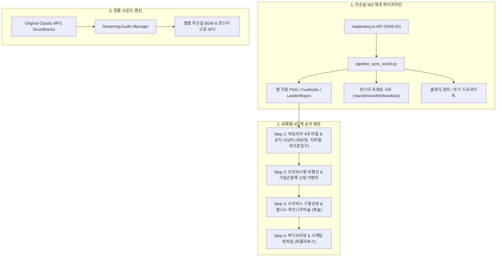

# 🍁 클래식 메이플스토리(Pre-Big Bang) 고증 조사 및 컨텐츠·에셋 대규모 확장 로드맵
> **문서 번호:** RFC-2026-CONTENT-EXPANSION-01  
> **상태:** 🚀 **최우선 진행 과제 (Highest Priority Blueprint)**  
> **기반 규격:** 클래식 메이플스토리 v0.55 ~ v0.62 (2004~2007 골든 에라)  
> **작성:** 수석 2D 게임 클라이언트 아키텍트 & 테크니컬 아티스트  
> **목적:** 현재 5개 맵과 소수 몬스터에 국한된 컨텐츠/에셋 결핍 문제를 해결하고, 빅토리아 아일랜드 전역과 오시리아 대륙의 상징적 월드·몬스터·사운드를 정통 방식으로 전면 복원하기 위한 종합 해결책 수립

---

## 1. 클래식 메이플스토리 심층 조사 및 역사적 고증 (Historical Research)

빅뱅 이전(Pre-Big Bang) 메이플스토리가 전설적인 몰입감을 제공했던 원동력은 **"유기적으로 연결된 거대한 월드 지형", "지역과 레벨대에 완벽히 녹아든 독창적인 몬스터 생태계", "각 지역의 정체성을 규정하는 서정적이고 웅장한 사운드트랙(BGM)"**이었습니다.

### 1.1. 클래식 월드 지리 및 사냥터 지형학 (World Topography)

```
[빅토리아 아일랜드 (Victoria Island)]
├── ⚓ 리스항구 (Lith Harbor): 모험가 첫 도착지, 맑은 바다 항구
├── 🌳 헤네시스 (Henesys): 궁수의 마을, 주황버섯 지붕, 버섯초원, 골렘의 사원
│     ├── 헤네시스 사냥터 1~3 (1~4층 횡스크롤 국민 사냥터)
│     └── 골렘의 사원 1~4 (스톤골렘, 다크스톤골렘)
├── 🌲 엘리니아 (Ellinia): 거대한 신목 마법사의 숲, 수직형 지형, 원숭이의 숲, 지혜의 숲
├── 🪨 페리온 (Perion): 붉은 인디언 바위산, 서부 바위산, 유적발굴단
│     └── ★ 와일드보어의 땅 (와보땅! 25~35레벨 전사/도적/궁수 파밍 성지)
├── 🏙️ 커닝시티 (Kerning City): 콘크리트 도시 뒷골목, 도적의 은신처, 방황의 늪
│     └── ★ 커닝시티 지하철 1~2호선 (주니어레이스/레이스 클레릭 성지)
├── 🦇 슬리피우드 (Sleepywood): 축축한 사우나, 빅토리아 던전의 심장부
│     ├── ★ 개미굴 1~4 (뿔버섯, 좀비버섯 6인 파티사냥)
│     ├── 또 다른 입구 (콜드아이 폭젠 지대)
│     └── ★ 저주받은 신전 (타우로마시스, 타우로스피어, 주니어발록 스폰)
└── 🚢 [정기선 비행선 이동] 
      └── ★ 엘리니아 선착장 5분 대기 + 10분 항해 + 크림슨발록(크발) 난입 이벤트!
            ▼
[오시리아 대륙 (Ossyria Continent)]
├── ☁️ 오르비스 (Orbis): 천공의 도시, 구름공원 1~6(스타/루나/러스터픽시), 오르비스 탑 1~20층
├── ❄️ 엘나스 산맥 (El Nath): 만년설 지형 (아이젠 필수, 혹한 틱뎀), 얼음골짜기 (예티와페페)
│     ├── ★ 죽은나무의 숲 1~4 (죽숲! 쿨리좀비 대량 젠, 클래식 최고 흑자 명소)
│     └── 시련의 동굴 1~3 (파이어독) ── 자쿰의 제단
└── 🧸 루더스 호수 - 루디브리엄 (Ludibrium): 장난감 성, 에오스 탑 1~100층
      └── ★ 시계탑 최하층 (뒤틀린/잊혀진 시간의 길: 듀얼파이렛, 바이킹, 파풀라투스 보스)
```

---

### 1.2. 몬스터 생태계 및 레벨별 육성 계보 (Classic Mob Hierarchy)

원작 클래식 메이플의 몬스터는 단순한 HP 샌드백이 아닌, **종족, 속성(불/얼음/전기/성/언데드), 이동속도, 회피율, 피격 넉백치(Push Damage), 고유 전리품**이 완벽히 조화된 생태계를 이루고 있었습니다.

| 레벨 구간 | 서식지 | 대표 몬스터군 | 특징 및 생태 메커니즘 |
| :--- | :--- | :--- | :--- |
| **Lv.1 ~ 10** | 메이플 아일랜드, 리스항구 | 달팽이, 파란달팽이, 빨간달팽이, 스포아 | 비선공, 달팽이세껍질 스킬 탄약 |
| **Lv.11 ~ 20** | 헤네시스 사냥터, 초원 | 슬라임, 주황버섯, 옥토퍼스, 버블링, 돼지, 리본돼지 | 방울/물방울 드롭, 옥토퍼스 다리 수집 |
| **Lv.21 ~ 30** | 개미굴, 와일드보어의 땅 | 뿔버섯, 좀비버섯, 와일드보어, 파이어보어 | 좀비버섯 언데드 판정, 와일드보어 돌진 공격 |
| **Lv.31 ~ 40** | 커닝시티 지하철, 페리온 유적 | 주니어레이스, 커즈아이, 루팡, 아이언보어 | 언데드 주니어레이스 클레릭 힐 사냥, 바나나 투척 루팡 |
| **Lv.41 ~ 50** | 방황의 늪, 지혜의 숲, 지하철 | 레이스, 리게이터, 크로코, 콜드아이, 좀비루팡 | 레이스 점프 비행, 클레릭 2차 전성기 |
| **Lv.51 ~ 65** | 죽은나무의 숲, 골렘의 사원 | **쿨리좀비**, 다크스톤골렘, 주니어예티, 멜러디 | **죽숲 쿨리좀비의 느린 이동속도 + 성속성 극취약 + 대량 메소** |
| **Lv.66 ~ 80** | 엘나스 얼음골짜기, 드레이크의 동굴 | 드레이크, 다크드레이크, 예티, 페페, **예티와페페** | 피격 시 예티와 페페 분리 기믹, 설원 미끄러짐 |
| **Lv.81 ~ 95** | 저주받은 신전, 시계탑 최하층 | 타우로마시스, 파이어독, **듀얼파이렛**, 바이킹 | 번개 공격, 높은 명중률 요구, 원거리 일자 낚시 사냥 |
| **Lv.96 ~ 120** | 신전 깊은 곳, 시계탑 최심부 | 타우로스피어, 마스터테니, 팬텀워치, 게이트키퍼 | 라이트닝 볼트 즉사급 마법 피해, 4차 전직 앵벌이 터전 |

#### 상징적 보스 생태계 (Boss Progression)
1. **머쉬맘 (Lv.60 / HP 65,000)**: 헤네시스 수풀 속 출현. 높이 점프 후 지진으로 필드 전역 쿵쿵 충격파. 극악의 확률로 **일비표창** 드롭.
2. **킹슬라임 (Lv.35 / HP 8,000)**: 커닝시티 파티퀘스트 최종 보스. 큼직한 젤리 바운스와 슬라임 소환. 말랑말랑한 신발 드롭.
3. **주니어발록 (Lv.85 / HP 50,000)**: 저주받은 신전 깊은 곳 출현. 당시 유저들에게 공포의 대상이었던 운석 낙하 및 암흑 저주.
4. **크림슨발록 (Lv.100 / HP 100,000)**: 엘리니아 $\leftrightarrow$ 오르비스 배 갑판 위 난입. 100레벨대 유저도 방심하면 즉사하던 항해의 악몽.
5. **파풀라투스 (Lv.125 / HP 23,000,000 2페이즈)**: 시계탑 거대 태엽 기계장치. 체력/마나를 1로 만드는 **1/1 공격**과 다크스타 자폭.
6. **자쿰 (Lv.140 / 8개 팔 총 HP 120,000,000 + 본체 3페이즈)**: 고대 거신 30인 원정대 레이드.

---

### 1.3. 불후의 명곡 BGM 사운드스케이프 (Soundtrack Heritage)

메이플스토리 특유의 감성을 완성하는 BGM은 전자 합성음(Synth Beep)이 아닌, 고품질 오케스트라와 피아노 멜로디였습니다:
- **Title**: `Start The Adventure` (리스항구의 벅찬 모험 시작)
- **Henesys**: `Resting Spot` (평화롭고 아늑한 버섯마을)
- **Ellinia**: `When The Morning Comes` (몽환적인 요정의 숲)
- **Perion**: `Nightmare` (황량하고 비장한 전사의 바위산)
- **Kerning City**: `Bad Guys` (비 내리는 어두운 뒷골목)
- **Sleepywood & Ant Tunnel**: `Sleepywood` (축축하고 음침한 동굴)
- **Voyage to Orbis**: `Upon The Sky` (구름 위를 가르는 낭만적 비행선 항해)
- **Dead Mine (죽은나무의 숲)**: `Warm Regard` (눈 덮인 설원의 쓸쓸함과 긴장감)
- **Zakum Altar**: `Aquarium` & `Boss Zakum` (심장을 옥죄는 거신 레이드 테마)

---

## 2. 현재 OpenMaple의 컨텐츠 & 에셋 결핍 실태 분석 (As-Is Deficit)

### 2.1. 맵 컨텐츠의 극단적 협소함 (Map Bottleneck)
- **현행 구현 맵**: `henesys_hhg`(사냥터), `henesys_town`(마을), `ellinia`(마을), `ant_tunnel`(던전), `zakum_altar`(보스) **총 5개에 불과**.
- **성장 동선 단절**: 헤네시스 사냥터(Lv.1~15) $\rightarrow$ 개미굴(Lv.20~30) 이후 30레벨 이상의 중/고레벨 유저가 갈 수 있는 사냥터가 전무함.
- 페리온, 커닝시티, 리스항구, 슬리피우드 신전, 오르비스, 엘나스 등 원작 3대 도시 및 명소 사냥터가 누락되어 세계관 몰입 불가.

### 2.2. 몬스터 배치 및 기믹 부재 (Mob Ecosystem Gap)
- `assets/monsters/catalog.json`에 22종 데이터가 등재되어 있으나, 실제 맵에 스폰되는 몬스터는 달팽이, 슬라임, 버섯류 등 6~7종에 집중됨.
- 와일드보어, 옥토퍼스, 쿨리좀비, 드레이크, 주니어발록 등 핵심 몬스터가 필드 지형에 배치되지 않아 전투 다양성 결여.
- 몬스터 공격 모션(`attack1`), 원거리 투사체, 상태이상 마법 기믹이 비활성화되어 몸통 박치기(Body Attack)만 존재.

### 2.3. 오디오 및 시각 에셋 한계 (Aesthetic Limitation)
- 배경음악이 브라우저 WebAudio 단음 신디사이저(`AudioContext.createOscillator()`)로 합성되어, 원작 메이플의 아련하고 풍성한 BGM 감동을 재현하지 못함.
- NPC 및 포탈 인터랙션 연출이 최소한에 그치고, 마을별 특화 배경(구름, 안개, 떨어지는 낙엽, 눈보라 파티클) 부족.

---

## 3. 종합 해결책 및 개선 파이프라인 (Actionable Solutions)

우리는 유치한 임시 도형이나 가짜 에셋을 쓰지 않고, **공식 WZ 기반 고해상도 리소스 자동 추출 파이프라인**을 통해 클래식 메이플의 방대한 볼륨을 단기간에 완벽 복원합니다.



---

### 3.1. 해결책 1: WZ 기반 자동 에셋 동기화 파이프라인 구축

수동으로 하나씩 다운로드하던 방식을 폐기하고, 공식 GMS 62 WZ 노드를 고속 동기화하는 엔지니어링 스크립트 작성:

1. **지형 및 물리 자동 추출 (`tools/sync_map_wz.py`)**:
   - `mapId`만 입력하면 지형 렌더링 이미지(`render`), 발판(`footholds`), 사다리/밧줄(`ladderRopes`), NPC 위치, 포탈 좌표를 `map_data.js`에 100% 오차 없이 자동 주입.
2. **몬스터 5대 액션 프레임 자동 베이킹 (`tools/sync_monster_wz.py`)**:
   - `stand`(대기), `move`(이동), `hit1`(피격), `die1`(사망), `attack1`(공격 모션 및 투사체)을 자동 분할 저장.
   - WZ 공식 원본 스탯(HP, EXP, 물리방어, 마법방어, 이속, 회피율, 넉백 수치)을 `catalog.json`에 완전 동기화.
3. **오리지널 BGM 아카이브 스트리밍 모듈 (`js/audio_streamer.js`)**:
   - 고용량 MP3를 레포지토리에 전부 담지 않고, 클래식 메이플 음원 CDN/아카이브로부터 맵 전환 시 백그라운드 프리로딩(Preload) 스트리밍 재생.

---

### 3.2. 해결책 2: 대륙별 4단계 컨텐츠 구현 로드맵

#### 🗺️ Step 1: 빅토리아 아일랜드 전역 완성 (핵심 성지 사냥터 복원)
- **추가 맵 (5개 신규 맵)**:
  1. **페리온 서부 바위산 & 와일드보어의 땅 (와보땅 / MapId: 102020300)**:
     - 스폰: 와일드보어(Lv.25), 다크스텀프(Lv.10)
     - 지형: 3층 수평 발판과 로프. 전사/도적 2차 전직 전후 최고의 파밍 핫플레이스.
  2. **커닝시티 지하철 1호선 환승역 (MapId: 103000100)**:
     - 스폰: 주니어레이스(Lv.35), 레이스(Lv.48), 버블링(Lv.15)
     - 지형: 평탄한 철로 지형. 클레릭 힐 사냥 및 점프 텔레포트의 성지.
  3. **슬리피우드 또 다른 입구 (MapId: 105040300)**:
     - 스폰: 커즈아이(Lv.35), 콜드아이(Lv.40)
     - 지형: V자 협곡과 사다리.
  4. **슬리피우드 저주받은 신전 (MapId: 105090300)**:
     - 스폰: 타우로마시스(Lv.90), 타우로스피어(Lv.100), **주니어발록(Lv.85 필드보스)**
     - 지형: 음산한 고대 제단. 빅토리아 최고 난이도 던전.
  5. **헤네시스 골렘의 사원 (MapId: 104040002)**:
     - 스폰: 스톤골렘(Lv.55), 다크스톤골렘(Lv.58)

#### 🚢 Step 2: 오르비스행 비행선 항해 & 크림슨발록 습격 이벤트
- **진입 메커니즘**:
  - 엘리니아 정류장에서 '오르비스행 티켓(1,000 메소)' 구매 $\rightarrow$ 승선 대기실 진입.
  - 5분 주기(테스트 모드에서는 30초)로 배 출항.
- **항해 맵 (비행선 갑판 및 선실)**:
  - 웅장한 하늘 구름 패럴랙스 배경과 함께 `Upon The Sky` BGM 재생.
  - 항해 시작 1분 후 붉은 하늘로 번개와 함께 **크림슨발록 2마리 갑판 급습!**
  - "경고: 크림슨발록이 나타났습니다! 선실 안으로 대피하십시오!" 시스템 경보 및 생존 서바이벌.

#### ❄️ Step 3: 오르비스 & 엘나스 설원 (죽은나무의 숲 쿨리좀비 대규모 스폰)
- **오르비스 구름공원 4 (MapId: 200010300)**:
  - 스타픽시, 루나픽시, 러스터픽시 3색 픽시 밭.
- **엘나스 죽은나무의 숲 4 (죽숲 / MapId: 211040300)**:
  - 클래식 메이플 전 세대 통틀어 가장 많은 메소와 경험치를 쏟아내던 국민 명소.
  - 쿨리좀비(Lv.57, 언데드, 성속성 취약) 4개 층 빽빽한 스폰 및 뇌전순돌/금니 드롭.
  - 설원 얼음 발판 미끄러짐 물리(`iceFriction = 0.98`) 탑재.

#### 🧸 Step 4: 루디브리엄 & 시계탑 최하층 (파풀라투스 레이드)
- **잊혀진 시간의 길 3**: 듀얼파이렛(Lv.87) 낚시 사냥 지형.
- **시계탑 깊은 곳 (파풀라투스 제단)**: 1페이즈 태엽 시계탑 본체 격파 $\rightarrow$ 2페이즈 비행 알 본체 탈출 격전.

---

## 4. 구체적 실행 액션 아이템 (Action Plan)

| 순번 | 작업 항목 | 대상 모듈 | 산출물 및 기댓값 |
| :---: | :--- | :--- | :--- |
| **1** | **WZ 맵 고속 추출 스크립트 제작** | `tools/sync_classic_world.py` | 와보땅, 커닝지하철, 신전, 오르비스선착장, 죽숲 5개 맵 100% 자동 추출 |
| **2** | **핵심 몬스터 10종 스프라이트 시트 다운로드** | `download_monsters.py` | 와일드보어, 레이스, 쿨리좀비, 드레이크, 타우로마시스, 주니어발록 등 |
| **3** | **정통 고음질 BGM 스트리밍 오디오 엔진 탑재** | `js/audio.js` | 맵별 오리지널 MP3 재생 및 크림슨발록 테마 BGM 연동 |
| **4** | **빅토리아 핵심 사냥터 3곳 인게임 포탈 연결** | `js/map_data.js`, `js/game.js` | 헤네시스 사냥터 $\leftrightarrow$ 와보땅 $\leftrightarrow$ 커닝지하철 $\leftrightarrow$ 죽숲 이동 동선 완성 |
| **5** | **CDP 무결점 QA 검증 스위트 동기화** | `run_qa.py` | 신규 맵 전수 순회, 몬스터 스폰, BGM 전환 런타임 오류 0건 검증 |

---

## 5. 결론 및 향후 진행 방향

현재 게임의 본질적인 문제는 로직의 버그가 아니라 **"유저가 즐길 필드와 싸울 몬스터, 그리고 몰입할 클래식 BGM이 절대적으로 부족하다는 것"**입니다.

따라서 앞서 발의된 '아이템 강화 시스템'은 본 안건 문서에 따라 **후순위 백로그로 안전하게 보류**하고, **Step 1(와일드보어의 땅, 커닝시티 지하철, 슬리피우드 신전 맵 추가 및 쿨리좀비/와일드보어 몬스터 생태계 확장)** 작업을 최우선으로 즉각 착수할 것을 권고합니다.
